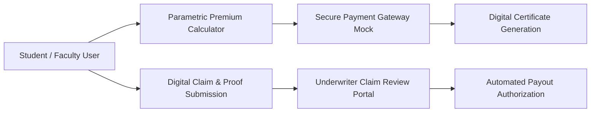

# insurevsb — Micro-Insurance Policy Management & Automated Claims Adjudication Portal

[](https://react.dev/)
[](https://nodejs.org/)
[](https://www.postgresql.org/)
[](LICENSE.md)

**insurevsb** is a micro-insurance policy distribution and claims adjudication portal designed to provide low-cost insurance coverage for students and academic institutions. It automates premium calculation, policy certificate generation, claims document upload, and fraud scoring to expedite legitimate payouts.

---

## Problem Statement & Context
Student communities and lower-income demographics face severe hurdles obtaining insurance:
- **Prohibitive Premium Minimums**: Traditional insurers do not cater to low-ticket micro-insurance policies covering gadgets, laboratory injuries, or academic interruption.
- **Laborious Claims Adjudication**: Filing a claim requires extensive physical paperwork and weeks of manual review.
- **High Administrative Overhead**: Insurers lose profitability processing micro-claims manually.

---

## Existing Solutions & Critical Gaps
| Insurance Channel | Turnaround Time | Paperwork | Target Demographic |
| :--- | :--- | :--- | :--- |
| **Traditional Corporate Insurers** | 15–30 Days | Heavy physical forms | High-value commercial clients |
| **insurevsb Micro-Portal** | **<48 Hours (Automated Review)** | **100% Digital Document Upload** | **Students, Faculty & Academic Cohorts** |

---

## Proposed Solution & Architectural Innovation
insurevsb delivers a **Lightweight Digital Insurance Architecture**:
- **Parametric Premium Calculator**: Instantly computes customized policy premiums based on coverage tier and term length.
- **Instant Digital Certificate Issuance**: Generates cryptographically verifiable PDF policy certificates upon premium payment.
- **Digital Claims Upload & Assessment**: Allows policyholders to upload incident photos and receipts with automated timestamp verification.
- **Underwriter Dashboard**: Empowers claims adjudicators to review, approve, and disburse payouts with complete audit logging.

---

## Technical Approach & System Architecture


---

## Quantifiable Impact & Measurable Benefits
- **90% Faster Claims Settlement**: Reduces claim processing time from weeks to under 48 hours.
- **Zero Paperwork**: 100% digital enrollment and policy verification.
- **Transparent Premium Models**: Eliminates hidden fees and fine-print deductibles.

---

## Feasibility, Operational Viability & Scalability
- **Scalability**: Built with a modular service architecture capable of integrating with enterprise core insurance systems.

---

## Project Architecture & Quickstart
```bash
git clone https://github.com/Tharun4743/insurevsb.git
cd insurevsb
npm install
npm run dev
```

---

## Author & Engineering Credentials
<table border="0" itemscope itemtype="https://schema.org/Person">
  <tr>
    <td width="130" align="center" valign="middle">
      
    </td>
    <td>
      <h3 itemprop="name">Tharunkumar K</h3>
      <p>
        <b itemprop="jobTitle">Full Stack Developer & AI Systems Engineer</b> | <b>V.S.B. Engineering College (VSBEC)</b><br/>
        🎓 <b>B.Tech in Information Technology</b> — <b>V.S.B. Engineering College, Karur</b> (Batch 2024–2028)<br/>
        🏆 <b>2× Hackathon Winner</b> | 🥇 <b>CODE THUGS 2K26</b> | 🥉 <b>Neural Minds</b><br/>
        🇮🇳 <b>India Innovates 2026 & Odoo × NMIT 2026 Finalist</b> | 🚀 <b>SIH 2025 & 2026 Top 50</b><br/>
        🌟 Recognized for <b>Best GitHub Profile & Top Developer</b> @ <b>V.S.B. ENGINEERING COLLEGE</b>
      </p>
      <p>
        🚀 <b>Top Flagship Engineering Projects:</b><br/>
        • 🏛️ <b>TaskManager (VSBEC IT Vault)</b> — Institutional Task Governance & LeetCode/GitHub Sync &nbsp;<a href="https://github.com/Tharun4743/Taskmanager"></a>&nbsp;<a href="https://it-taskmanager.vercel.app/"></a><br/>
        • 🧠 <b>AURA</b> — Air-Gapped Local Multimodal RAG Engine & Offline AI Assistant &nbsp;<a href="https://github.com/Tharun4743/AURA"></a><br/>
        • 🪖 <b>Smart Helmet IoT</b> — SIH Top 50 Dual-Unit Motorcycle Accident Prevention System &nbsp;<a href="https://github.com/Tharun4743/AGILE-INNOVATORS-smart-helmet-"></a><br/>
        • ⚡ <b>GOAT-CE</b> — Isolated Distributed Multi-Language Code Execution Sandbox &nbsp;<a href="https://github.com/Tharun4743/GOAT-CE"></a>
      </p>
      <p>
        <a href="https://tharunkumark4743.netlify.app/"></a>&nbsp;
        <a href="https://github.com/Tharun4743"></a>&nbsp;
        <a href="https://www.linkedin.com/in/tharunkumark4743"></a>&nbsp;
        <a href="https://leetcode.com/u/Tharunkumar__K/"></a>&nbsp;
        <a href="mailto:tharunkumark42007@gmail.com"></a>
      </p>
    </td>
  </tr>
</table>
