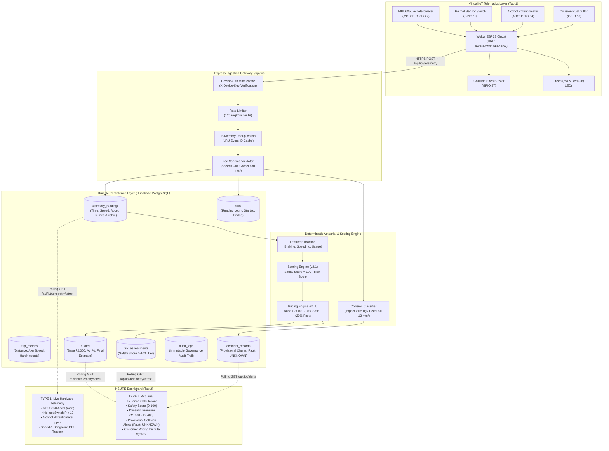
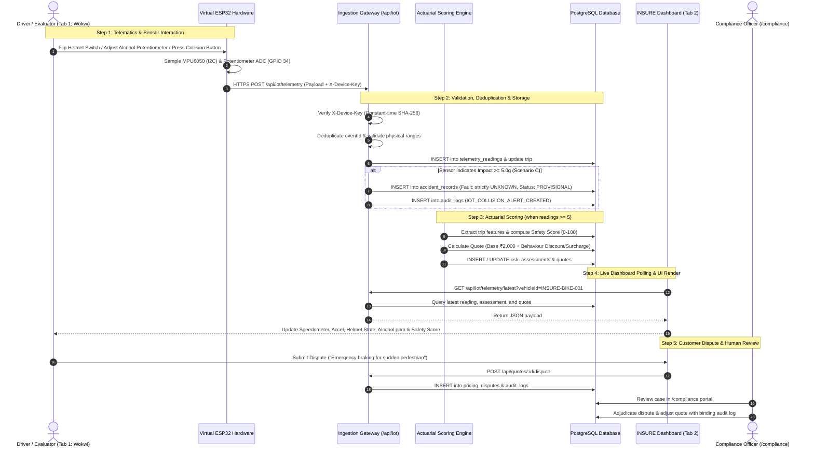
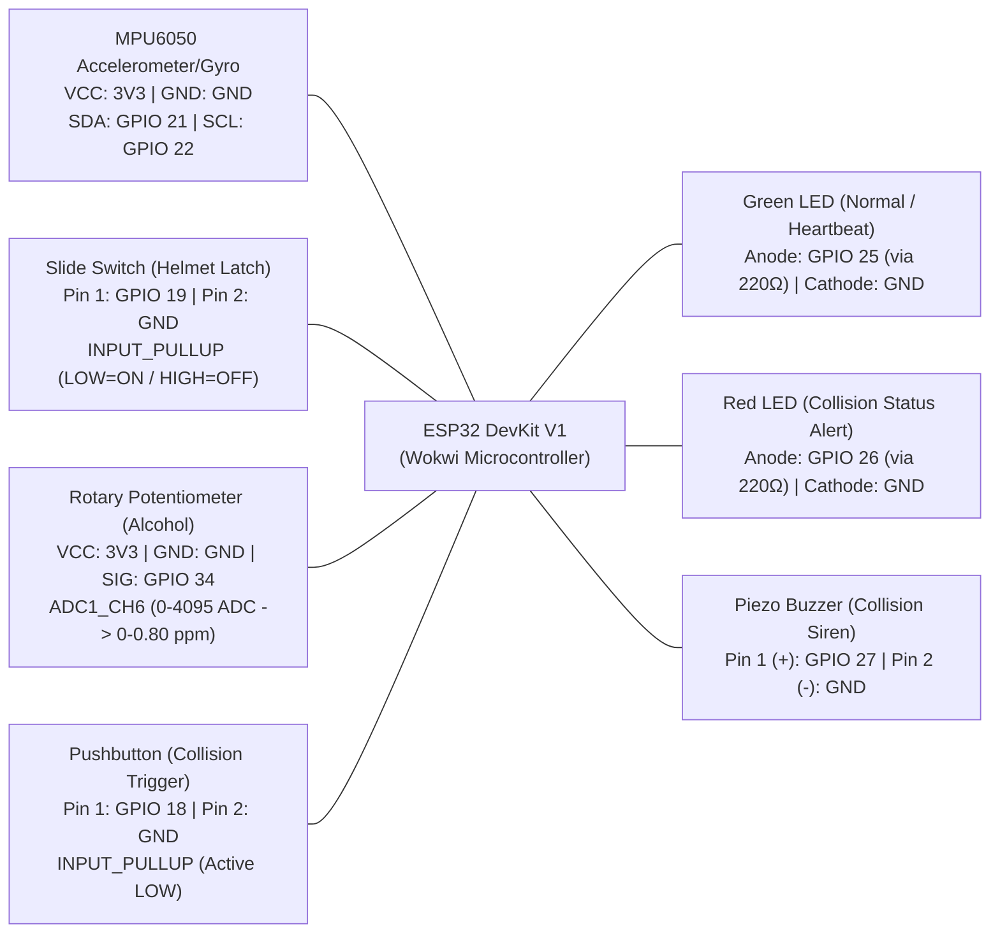

# INSURE — InsurTech & IoT Telematics Insurance Pricing Platform

> **Smarter Driving. Fairer Insurance.**  
> A privacy-first, production-ready behavioural insurance pricing platform that combines consented real-world vehicle telematics and approved IoT measurements with insurer-approved risk factors, explainable scoring, Brevo SMTP authentication, and role-based access control.

---

## 📌 Problem Statement

Create an insurance pricing platform that uses consented real-world behaviour data, such as vehicle telematics or approved IoT measurements, to inform premiums alongside insurer-approved risk factors.

---

## ⚠️ Problems Faced & Challenges

1. **Static Legacy Pricing vs. Actual Usage:**  
   Traditional actuarial pricing models rely on static demographic aggregates (age, postal code, vehicle category) and fail to capture real differences in actual driving behavior, time-of-day exposure, and vehicle usage.

2. **Noisy and Incomplete Behavioural Data:**  
   Real-world IoT and device sensors produce noise, corrupted telemetry packets, GPS drift, temporary signal dropouts, and accelerometer spikes. Penalizing sensor flaws as reckless driving erodes trust and produces discriminatory premiums.

3. **Privacy Concerns & Continuous Surveillance:**  
   Continuous tracking creates severe privacy exposure. Drivers must retain sovereign consent controls over their telemetry, with strict data minimization principles ensuring that raw coordinates are discarded and only aggregate safety indicators are processed.

4. **Black-Box Pricing & Customer Distrust:**  
   Opaque machine learning or arbitrary dynamic pricing changes create confusion and regulatory non-compliance. Without explainable factor-level pricing breakdowns and human review channels, customers lose faith in behavioural insurance models.

---

## 💡 Suggested Approach & Solution

INSURE provides an end-to-end deterministic actuarial and telemetry architecture:

1. **Defensive Device Data Validation:**  
   Every batch of telemetry readings undergoes strict 9-rule defensive validation. Impossible speeds, clock backward jumps, missing sequences, or sensor glitches are classified as data quality defects and safely quarantined without penalizing the driver.

2. **Exposure-Normalized Usage Measures:**  
   Telemetry indicators are normalized per 100 km of driving exposure, evaluating harsh deceleration (>0.4g), rapid acceleration, speed compliance (>80 km/h), and night-time driving (23:00–04:00).

3. **Transparent & Validated Pricing Rules:**  
   A deterministic, explainable actuarial formula combines insurer-approved base rates with transparent behavioral discounts/surcharges (capped at 40%) and separate accident claim history adjustments:
   $$\text{Final Premium} = \text{Base Premium} \times (1 + \Delta_{\text{behaviour}} + \Delta_{\text{claims}})$$

4. **Data Minimization & Sovereign Privacy Controls:**  
   Users explicitly grant or withdraw telematics processing consent at any time via a dedicated consent portal. Telematics ingestion halts immediately if consent is withdrawn.

5. **Human-in-the-Loop Review & Dispute Pipeline:**  
   Unusual sensor cases, ambiguous events, and customer disputes (e.g., emergency obstacle avoidance) are routed directly to the **Pricing & Compliance Officer** queue for binding human audit and adjudication.

6. **Automated Algorithmic Fairness Monitoring:**  
   Continuous fairness tracking across risk cohorts ensures that penalties correlate strictly with driving risk rather than socio-demographic indicators or data quality artifacts.

---

## 🏗️ Detailed Architecture & How INSURE Achieves This

### 1. System Architecture & Data Flow



---

### 2. End-to-End Sequence Diagram (Telemetry, Scoring, and Dispute Workflow)



---

### 3. Virtual Hardware Pin Mapping (`diagram.json`)

The virtual circuit is hosted and interactive at:  
👉 **[https://wokwi.com/projects/478002558874029057](https://wokwi.com/projects/478002558874029057)**



---

## 📊 Dual-Tier Dashboard Architecture (The "2 Types")

The dashboard provides two complementary views in real time:

### Type 1: Live Virtual Circuit Hardware Data
- **MPU6050 6-DOF Accelerometer:** Captures real-time acceleration (m/s²) and impact vibrations ($g$).
- **Optical Helmet Latch Switch:** Reads actual logic level of `GPIO 19` (Green badge `ON` vs Red badge `NOT DETECTED`).
- **Simulated Breath Alcohol Potentiometer:** Reads analog voltage on `GPIO 34` (0–4095 raw ADC mapped to 0.00–0.80 ppm).
- **Collision Pushbutton:** Live `GPIO 18` trigger sensing severe impact ($>5.0g$).
- **Speed & GPS Tracking:** Bangalore Tech Corridor Expressway route progress (12.9716° N, 77.5946° E).

### Type 2: Scenario-Based Actuarial Insurance Calculations
- **Safety Score Gauge (0–100):** Evaluated against standard actuarial tiers:
  - **Tier 1 (Safe Driver, Score 80–100):** Moderate speed, helmet worn, smooth braking $\to$ **10% Discount (₹1,800/yr)**.
  - **Tier 2 (Standard Risk, Score 50–79.99):** Normal commute $\to$ **0% Adjustment (₹2,000/yr)**.
  - **Tier 3 (Elevated Risk, Score < 50):** Overspeeding, missing helmet, elevated alcohol $\to$ **+20% Surcharge (₹2,400/yr)**.
- **Fair Actuarial Pricing Principles:**
  1. **Statutory Decoupling:** Insurance claims settlement is strictly independent of telematics risk scores. Risk scores cannot reduce legitimate insurance payouts.
  2. **Insufficient Data Protection:** Trips under 1.0 km or missing sensor packets default safely to baseline pricing (₹2,000) with 0% penalty.
  3. **Neutral Collision Handling:** Impact spikes ($>5g$) create **provisional alerts with `Fault Status: UNKNOWN`**. Sensor readings alone never prove driver fault.

---

## 👥 Three Dedicated Role Portals (RBAC)

| Role | Provisioned Account | Route | Core Responsibilities |
|---|---|---|---|
| **Customer / Policyholder** | `tharunkumark4743@gmail.com` | `/` | Manage consent, view trips, inspect factor-level quotes, submit pricing disputes |
| **Insurance Admin / Owner** | `tharunkumark42007@gmail.com` | `/admin` | Portfolio metrics, loss ratios, customer account lifecycle, publish pricing rules |
| **Pricing & Compliance Officer** | `vsbecitc2428@gmail.com` | `/compliance` | Audit algorithmic fairness, review telematics warnings, adjudicate customer disputes |

*Default password for initial provisioned accounts: `123456`*

---

## 🛠️ Technology Stack

- **Firmware / Hardware Simulation:** Wokwi ESP32 DevKit V1, Wire/I²C MPU6050, WiFiClientSecure, HTTPClient, Arduino C++.
- **Backend API:** Node.js, Express, TypeScript, Zod, JWT RBAC, Bcrypt, Rate Limiting, Nodemailer / Brevo SMTP.
- **Database:** Supabase PostgreSQL with pooled connection retry resilience and deterministic idempotency.
- **Frontend Dashboard:** React 18, Vite, TypeScript, Tailwind CSS, Lucide Icons, Recharts.
- **Testing:** Jest, Supertest, 100% passing automated test suite (23 of 23 IoT telematics tests).

---

## 🚀 Two-Tab Virtual Demonstration Setup (For Judges)

Open your browser with two side-by-side tabs:

| Tab 1: Virtual Hardware (Wokwi) | Tab 2: Live Insurance Dashboard |
| :--- | :--- |
| **URL:** [https://wokwi.com/projects/478002558874029057](https://wokwi.com/projects/478002558874029057) | **URL:** [https://insurevsb.vercel.app/simulator](https://insurevsb.vercel.app/simulator) |
| Click **Play (Start Simulation)** | Sign In with demo account |

### Demonstration Sequence:
1. **Normal Commute:** Green heartbeat LED blinks on ESP32 $\to$ Tab 2 shows pulsing **`Live Stream Active`**, speed ~36 km/h, Helmet ON, Safety Score ~92, Premium ₹1,800.
2. **Interactive Switch:** Flip the Helmet switch in Wokwi $\to$ Tab 2 helmet badge changes to **`NOT DETECTED`**.
3. **Interactive Potentiometer:** Rotate alcohol knob in Wokwi $\to$ Tab 2 alcohol gauge updates dynamically in ppm.
4. **Trigger Collision:** Click the Red Pushbutton in Wokwi $\to$ Red LED illuminates, buzzer siren sounds, and Tab 2 displays a **`PROVISIONAL COLLISION ALERT`** with **`Fault: UNKNOWN`**.
5. **Two-Vehicle Collision:** Type `D` in Wokwi Serial Monitor $\to$ correlated events created for both `INSURE-BIKE-001` and `INSURE-BIKE-002` with neutral fault status.
6. **Reset:** Type `R` in Wokwi Serial Monitor $\to$ buzzer silences, alarm clears, and system returns to normal safe commute.

---

## 🧪 Local Execution Commands

### Start Backend Locally:
```bash
cd backend
npm install
npm run dev
```

### Start Frontend Locally:
```bash
cd frontend
npm install
npm run dev
```

### Run Automated IoT Test Suite:
```bash
cd backend
npm test -- tests/iot_telematics.test.ts
```
*(All 23 tests pass against remote Supabase PostgreSQL).*

---

## ⚡ Fast 1-Click Access & Live Simulation

- **1-Click Role Login:** The Sign-In screen at `/login` provides 1-click instant login cards loading the live provisioned accounts directly from remote Supabase PostgreSQL (`tharunkumark42007@gmail.com`, `vsbecitc2428@gmail.com`, `tharunkumark4743@gmail.com`).
- **Live Drive Streamer:** The **Virtual ESP32 Telematics Live Monitor** tab features a live telematics streamer that injects real dynamic sensor packets directly into Supabase PostgreSQL for Safe, Risky, and Collision scenarios.
- **Active UI Utilities:** Includes functional **Export Custom Report (CSV download)**, **Dark/Light Theme toggle**, and **Interactive Notifications Center**.

---

## 📄 License

This project is licensed under the **MIT License** — see the [LICENSE](LICENSE) file for details.
Copyright (c) 2026 Tharun Kumar & INSURE Contributors.

