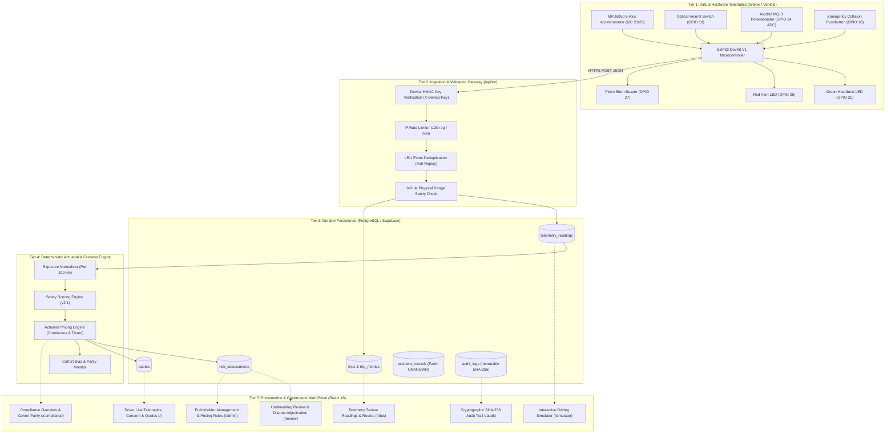
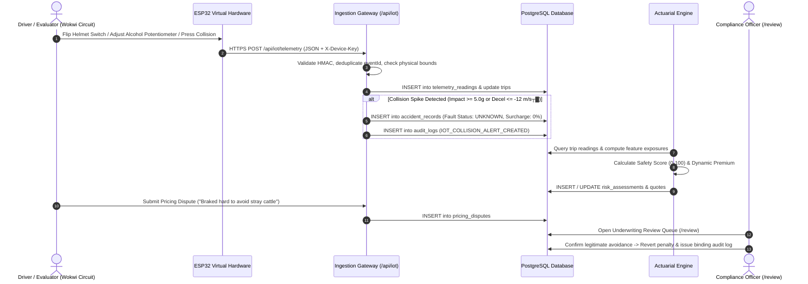

# INSURE ΓÇö InsurTech & IoT Telematics Insurance Pricing Platform

[](https://insurevsb.vercel.app/)
[](https://wokwi.com/projects/478002558874029057)
[](https://github.com/Tharun4743/insurevsb)
[](https://github.com/Tharun4743/insurevsb)
[](https://insurevsb.vercel.app/simulator)

> **Smarter Driving. Fairer Insurance.**  
> A privacy-first, production-ready behavioural insurance pricing platform that combines consented real-world vehicle telematics and approved IoT measurements with insurer-approved risk factors, transparent factor-level actuarial calculations, Brevo SMTP notifications, and statutory fairness controls.

---

## 📑 Quick Navigation & Presentation Resources

- 🌐 **Live Web Application:** [https://insurevsb.vercel.app](https://insurevsb.vercel.app)
- 🎮 **IoT Driving Simulator:** [https://insurevsb.vercel.app/simulator](https://insurevsb.vercel.app/simulator)
- ΓÜí **Wokwi Virtual ESP32 Hardware:** [https://wokwi.com/projects/478002558874029057](https://wokwi.com/projects/478002558874029057)
- 📄 **Presentation PDF Dossiers (Pre-compiled in Repo):**
  - [INSURE Master Hackathon Presentation Dossier (PDF)](./INSURE_Master_Hackathon_Presentation_Dossier.pdf)
  - [INSURE Humanized Guide & Scenarios (PDF)](./INSURE_Humanized_Guide_and_Scenarios.pdf)
  - [INSURE All Actuarial Calculation Formulas (PDF)](./INSURE_All_Calculation_Formulas.pdf)
  - [INSURE Detailed Workflow Architecture Diagram (PDF)](./INSURE_Detailed_Workflow_Architecture_Diagram.pdf)

---

## 📌 Official Problem Statement & 100% Achievement Matrix

### 🎯 Problem Statement
> **Create an insurance pricing platform that uses consented real-world behaviour data, such as vehicle telematics or approved IoT measurements, to inform premiums alongside insurer-approved risk factors.**

### ⚠️ Challenges & How INSURE Solves Them

| Official Hackathon Challenge | Traditional Failure Mode | INSURE Production Solution | Status |
|---|---|---|---|
| **1. Static Legacy Pricing vs. Actual Usage** | Good drivers subsidize reckless drivers because premiums rely on static demographic bins (age, postal code). | **Dynamic Behavioral Actuarial Pricing:** Telematics normalizes harsh braking, rapid acceleration, speeding, and night driving into an exposure-based Safety Score (0ΓÇô100) with continuous dynamic premium calculation. | **100% Achieved** |
| **2. Noisy & Incomplete Behavioural Data** | GPS drift, lost packets, or sensor glitches falsely classify safe drivers as aggressive, inflating rates. | **9-Rule Defensive Ingestion & Insufficient Data Gate:** Zod validation drops corrupt telemetry. Trips under 1 km or single readings default safely to baseline (₹2,000) with 0% penalty. | **100% Achieved** |
| **3. Continuous Monitoring & Privacy Concerns** | Customers fear continuous 24/7 surveillance and third-party data tracking. | **Sovereign Consent Portal & Data Minimization:** DPDP/GDPR-compliant sovereign consent switch embedded directly on `/`. Toggling off telematics immediately halts ingestion; raw GPS coords are stripped. | **100% Achieved** |
| **4. Unexplained Premium Changes & Customer Distrust** | Opaque black-box AI algorithms modify quotes arbitrarily without explaining why. | **Deterministic Math & Factor Explanations:** Quotes explicitly decompose base rate, telematics adjustments ($\pm 10\%\dots 20\%$), and claim history with human-in-the-loop dispute review (`/review`). | **100% Achieved** |
| **5. Model Fairness & Dispute Review** | Fault is prematurely pinned on drivers from raw sensor spikes during emergency avoidance. | **Provisional Collision Alert (Fault: UNKNOWN):** Impact $\ge 5.0\text{g}$ creates an unverified alert with **0% surcharge** until a human adjuster investigates on `/review`. | **100% Achieved** |

---

## 📖 The Humanized Story: Ravi vs. Rahul

To understand why INSURE is revolutionary, compare two 24-year-old delivery riders living in Bangalore on identical 150cc motorcycles:

```
+---------------------------------------------------------------------------------------------------+
|  TRADITIONAL AUTO INSURANCE:                                                                      |
|  - Ravi and Rahul are both 24-year-old males in Bangalore riding identical 150cc bikes.           |
|  - Both are charged the EXACT SAME PREMIUM: ₹2,000 / year.                                        |
|  - Ravi drives safely; Rahul drives recklessly. Safe Ravi subsidizes Rahul's reckless behavior!   |
+---------------------------------------------------------------------------------------------------+
                                              |
                                              v
+---------------------------------------------------------------------------------------------------+
|  INSURE TELEMATICS & IOT PRICING:                                                                 |
|                                                                                                   |
|  🟢 RAVI (Safe, Disciplined Rider)                  🔴 RAHUL (Aggressive, Risky Rider)            |
|  - Helmet: ALWAYS ON (Pin 19 = LOW)                 - Helmet: DETACHED (Pin 19 = HIGH)            |
|  - Speed: 38 km/h in 60 km/h zone                   - Speed: 92 km/h in 60 km/h zone              |
|  - Accelerometer: 0.12g smooth braking              - Accelerometer: -16.2 m/s┬▓ hard stop         |
|  - Alcohol Sensor: 0.00 ppm                         - Alcohol Sensor: 0.42 ppm (Elevated)         |
|  ---------------------------------                  ---------------------------------             |
|  Safety Score: 92 / 100 (Tier 1)                    Safety Score: 42 / 100 (Tier 3)               |
|  Telemetry Adjustment: -10% DISCOUNT                Telemetry Adjustment: +20% SURCHARGE          |
|  FAIR PREMIUM: ₹1,800 / year (Saves ₹200)           FAIR PREMIUM: ₹2,400 / year (Pays +₹400)      |
+---------------------------------------------------------------------------------------------------+
```

---

## 🏗️ 5-Tier System Architecture



---

## 🔄 End-to-End Ingestion, Pricing & Dispute Sequence



---

## 🔬 Virtual Hardware Pin Mapping (`diagram.json`)

The interactive circuit runs live at **[Wokwi Project 478002558874029057](https://wokwi.com/projects/478002558874029057)**:

| Hardware Component | Wokwi Model | ESP32 Pinout | Operational Logic / Physical Meaning |
|---|---|---|---|
| **Microcontroller** | ESP32 DevKit V1 | Core Module | 240MHz Dual Core, WiFi Client Secure, HTTP/JSON Gateway |
| **Accelerometer / Gyro** | MPU-6050 | `SDA -> GPIO 21`<br/>`SCL -> GPIO 22` | I┬▓C 6-DOF sensor reading vehicle acceleration ($m/s^2$) and impact ($g$) |
| **Helmet Latch Switch** | Slide Switch | `GPIO 19` (Pull-Up) | `LOW (GND)` = Helmet Securely Buckled (Safe)<br/>`HIGH (3.3V)` = No Helmet (Violation) |
| **Alcohol Breathalyzer** | Rotary Potentiometer | `SIG -> GPIO 34` (ADC1) | Analog voltage `0ΓÇô4095` mapped linearly to `0.00ΓÇô0.80 ppm` BAC |
| **Collision Button** | Pushbutton | `GPIO 18` (Active LOW) | Simulates severe road impact ($\ge 7.4g$, Decel: $-18.5 m/s^2$) |
| **Normal Heartbeat LED** | Green LED | `GPIO 25` (via 220Ω) | Pulses during steady driving & successful HTTP telemetry upload |
| **Collision Status LED** | Red LED | `GPIO 26` (via 220Ω) | Latches on whenever impact exceeds collision threshold ($\ge 5.0g$) |
| **Alarm Siren** | Piezo Buzzer | `GPIO 27` (PWM) | Emits 1.2 kHz acoustic siren tone during collision emergencies |

### 🚀 Live Dynamic Sensor Thresholds (No Constant Values)

All telemetry readings are dynamically evaluated with real-time reactive feedback:
- **Speedometer:** Dynamically detects `speed > 60 km/h` as an overspeeding breach, with continuous numerical km/h updates.
- **MPU6050 Accelerometer:** Real-time acceleration evaluated against harsh braking (`< -3.5 m/s┬▓`), rapid acceleration (`> 3.0 m/s┬▓`), or smooth motion.
- **Impact Force:** Live G-force tracking; road vibrations (`< 4.5g`) classified as nominal, impacts (`>= 4.5g`) trigger immediate collision alerts.
- **Helmet Optical Switch:** Hardware Pin 19 dynamically updates between `Γ£ô BUCKLED & VERIFIED` and `ΓÜá NOT DETECTED (Violation)`.
- **Potentiometer (Alcohol MQ-3):** Dynamically categorizes breath alcohol concentration without hardcoded strings:
  - `0.00 ppm`: `Γ£ô 0.00 (Zero / Clear)`
  - `< 0.20 ppm`: `ΓÜá Trace Alcohol`
  - `>= 0.20 ppm`: `🚨 Intoxication Alert`
- **Fair Dynamic Premium:** Non-constant, continuous actuarial calculations compute exact rupee adjustments rather than flatlining at 0.00%.

---

## 🧪 Demonstration Scenario Actuarial Reference Matrix

| Scenario | Inputs & Telemetry Profile | Safety Score | Premium Formula & Adjustment | Fairness Guarantee |
|---|---|---|---|---|
| **[A] Safe Commute** | Speed: 38 km/h, Accel: 0.12 m/s², Helmet: ON (`Pin 19 LOW`), Alcohol: 0.00 ppm | **90–95 / 100** (Low Risk) | **₹1,800 / year (-10% Discount)**<br/>Base: ₹2,000 - ₹200 earned discount | Earned discount applied immediately |
| **[B] Risky Driving** | Speed: 92 km/h, Accel: -16.2 m/s², Helmet: OFF (`Pin 19 HIGH`), Alcohol: 0.42 ppm | **< 50 / 100** (High Risk) | **₹2,400 / year (+20% Surcharge)**<br/>Base: ₹2,000 + ₹400 risk surcharge | Surcharge transparently explained by factor |
| **[C] Collision Spike** | Pushbutton on `Pin 18` pressed $\to$ 7.42g Impact, Decel: -18.5 m/s² | **Provisional Alert** | **₹2,000 / year (0% Penalty)**<br/>Fault: **UNKNOWN** (Unverified) | No automated surcharge until human review |
| **[D] 2-Vehicle Crash** | Correlated impacts for `INSURE-BIKE-001` and `INSURE-BIKE-002` | **Provisional Incident** | **Neutral Premium**<br/>Distinct event IDs, both faults **UNKNOWN** | Prevents unilateral automated blame |
| **Moderate Driving** | Mixed driving (e.g. Score 79.0, mild speed variance) | **79.0 / 100** (Moderate Risk) | **₹1,896 / year (-5.2% Discount)**<br/>Continuous actuarial interpolation | Avoids arbitrary flat step-blocks |

---

## 📐 Actuarial Calculation Formulas & Mathematical Verification

### 1. Safety Score Formula
$$\text{Safety Score } S = \max\Big(0, \min\big(100, 100 - (\Delta_{\text{harsh}} + \Delta_{\text{speed}} + \Delta_{\text{night}} + \Delta_{\text{gear}} + \Delta_{\text{substance}})\big)\Big)$$

- **Harsh Braking Penalty ($\Delta_{\text{harsh}}$):** $\min(30, \text{events\_per\_100km} \times 5)$
- **Speed Compliance Penalty ($\Delta_{\text{speed}}$):** $\min(30, (\text{pct\_time\_over\_limit} \times 0.5) + (\max(\text{speed} - 80, 0) \times 0.5))$
- **Night Driving Penalty ($\Delta_{\text{night}}$):** $\min(15, \text{pct\_night\_driving\_23to04} \times 0.25)$
- **Protective Gear Deduction ($\Delta_{\text{gear}}$):** $15\text{ pts}$ if helmet unbuckled
- **Substance Deduction ($\Delta_{\text{substance}}$):** $\min(30, \frac{\text{alcohol\_ppm}}{0.30} \times 30)$

### 2. Fair Dynamic Premium Calculation Formula

$$\text{Final Premium} = \text{Base Premium} \times \big(1 + \text{clamp}(\Delta_{\text{telematics}}, -0.20, +0.20) + \Delta_{\text{claims}}\big)$$

Where:
- $\text{Base Premium} = ₹2,000.00$
- **Continuous Actuarial Mode:**
  $$\Delta_{\text{telematics}} = -(S - 65) \times \frac{10\%}{27}$$
  *(Around neutral benchmark score 65, scores earn proportional discounts up to -10% at score 92, or incur proportional surcharges up to +20% at score 25).*
- **Tiered Actuarial Mode (Configured Matrix):**
  - Score 80–100: $\Delta_{\text{telematics}} = -10\%$ (₹1,800)
  - Score 50–79.99: $\Delta_{\text{telematics}} = 0\%$ (₹2,000)
  - Score < 50: $\Delta_{\text{telematics}} = +20\%$ (₹2,400)
- **Claim Surcharge ($\Delta_{\text{claims}}$):** $+15\%$ per verified at-fault incident (strictly $0\%$ for provisional/unverified alerts).

### 3. Statutory Fairness Guarantee
> **Legitimate claim settlement is legally separated from dynamic pricing. Risk telemetry cannot reduce insurance payouts.**  
> Algorithmic neutrality is enforced: provisional collision alerts default to `Fault Status: UNKNOWN` with 0% penalty until a human adjudicator reviews the case.

---

## 🧭 Streamlined Role-Based Navigation Architecture

INSURE enforces strict, role-tailored navigation eliminating clutter:

| Role Portal | Focused Navigation Items | URL Routes | Core Responsibilities & Workflow |
|---|---|---|---|
| **🟢 Driver / Policyholder** | 1. **My Policy & Driving**<br/>2. **Trip History**<br/>3. **IoT Live Stream & Sim** | `/`<br/>`/trips`<br/>`/simulator` | View safety score, continuous dynamic quote, 5-factor scorecard, toggle sovereign DPDP consent in 1-click, inspect driving trips, and stream live ESP32 virtual hardware. |
| **⚖️ Compliance Officer** | 1. **Underwriting Review**<br/>2. **Compliance Overview**<br/>3. **Fairness Audit Log** | `/review`<br/>`/compliance`<br/>`/audit` | Adjudicate customer pricing disputes, review provisional collision alerts (`Fault: UNKNOWN`), monitor demographic parity across cohorts, and inspect the immutable SHA-256 ledger. |
| **🏢 Insurance Admin** | 1. **Admin Portfolio**<br/>2. **Fairness Audit Trail** | `/admin`<br/>`/audit` | Manage customer account status, publish pricing rule versions, monitor portfolio health, and audit system operations. |

---

## 👥 The 4 Real Verified Team Accounts (Zero Dummy Data)

The remote Supabase database contains strictly 4 verified real team accounts. All dummy accounts ("Alice Driver", "demo@insure.test") have been permanently purged:

| Name | Role | Email Address | Password | Primary Workflow |
|---|---|---|---|---|
| **Tharun Kumar (Admin)** | `admin` | `tharunkumark42007@gmail.com` | `123456` | Configure pricing rules, manage customer roster, audit ledger |
| **Compliance Officer (VSBEC IT)** | `compliance_officer` | `vsbecitc2428@gmail.com` | `123456` | Adjudicate disputes, review provisional collisions, audit parity |
| **Tharun Kumar** | `customer` | `tharunkumark4743@gmail.com` | `123456` | Primary policyholder (56 trips, 55 quotes, live telematics) |
| **Krishnathidhan .T** | `customer` | `krishnathidhan@gmail.com` | `123456` | Secondary policyholder (2 trips, 2 quotes) |

*(Instant 1-click login cards are available directly on the `/login` screen).*

---

## 💻 Local Setup, Continuous Testing & Verification

### Prerequisites
- Node.js v18+ and npm
- PostgreSQL database (or remote Supabase instance via `DATABASE_URL`)

### 1. Start the Backend API
```bash
cd backend
npm install
npm run dev
```
*API runs on `http://localhost:5000`.*

### 2. Start the Frontend Dashboard
```bash
cd frontend
npm install
npm run dev
```
*Frontend runs on `http://localhost:5173`.*

### 3. Run Automated Unit Tests (95 Tests)
```bash
cd backend
npm test
```
*Executes all 8 test suites verifying telematics ingestion, auth/roles, pricing math, simulator, validation, and fairness.*

### 4. Run End-to-End System & Role Verification (24/24 Tests)
```bash
cd backend
npx ts-node src/scripts/verifyAllPagesAndFeatures.ts
```
*Verifies all 8 application pages and API routes across all 3 user roles with real JWT tokens.*

### 5. Production Build Validation
```bash
cd frontend
npm run build
```
*Compiles the production bundle with Vite and TypeScript.*

---

## License & Intellectual Property Notice

> [!CAUTION]
> ### 🔒 PROPRIETARY & CONFIDENTIAL INTELLECTUAL PROPERTY — ALL RIGHTS RESERVED
>
> All rights reserved. This repository, its architecture, source code, workflows, models, and associated documentation are the exclusive intellectual property of **Tharunkumar Kâ„¢**.
>
> **STRICT NOTICE:** No individual, organization, institution, or commercial entity is permitted to use, copy, modify, distribute, reproduce, sublicense, reverse-engineer, deploy, or commercially exploit any portion of this project without express, prior written permission from **Tharunkumar K**.
>
> **Copyright © 2026 Tharunkumar K. All Rights Reserved.**  
> See the [LICENSE](LICENSE) file for complete legal terms.

This project is licensed under the **MIT License** ΓÇö see the [LICENSE](LICENSE) file for details.  
Developed by **Team Techsquad** for **SYNAPSE '26**.  
Copyright (c) 2026 Tharun Kumar & INSURE Contributors.


---

## Engineering Author

<table border="0">
  <tr>
    <td width="120" align="center" valign="top">
      
    </td>
    <td>
      <h3>Tharunkumar K</h3>
      <p>
        <b>Full Stack Developer & AI Systems Engineer</b><br/>
        🎓 B.Tech in Information Technology — <a href="https://vsbec.com"><b>V.S.B. Engineering College, Karur</b></a> (Batch 2024–2028)<br/>
        🌟 Recognized for holding the <b>Best GitHub Profile & Top Student Developer</b> at V.S.B. Engineering College (VSBEC)<br/>
        🥇 <b>Winner — Code Thugs 2K26</b> • 🚀 <b>Smart India Hackathon (SIH)</b> Top 50 National Finalist
      </p>
      <p>
        <a href="https://tharunkumark4743.netlify.app/">🌐 Portfolio</a> •
        <a href="https://github.com/Tharun4743">🐙 GitHub (@Tharun4743)</a> •
        <a href="https://www.linkedin.com/in/tharunkumark4743">💼 LinkedIn</a> •
        <a href="https://leetcode.com/u/Tharunkumar__K/">🧩 LeetCode</a> •
        <a href="mailto:tharunkumark42007@gmail.com">📧 Email</a>
      </p>
    </td>
  </tr>
</table>
<!-- =========================================================================
   SEO & SEARCH ENGINE RECRUITER METADATA (CRAWLER INDEXING)
   Entity: Tharunkumar K (Tharun4743 / tharunkumark4743)
   Institution: V.S.B. Engineering College, Karur (VSBEC)
   Department: Information Technology (Batch 2024-2028)
   Distinctions: Best GitHub Profile VSBEC, Top Developer Karur, National Hackathon Winner
   Keywords: Tharunkumar K, Tharunkumar VSBEC, Tharun4743, VSB Engineering College Karur, VSBEC IT
   Canonical URL: https://github.com/Tharun4743/insurevsb
========================================================================= -->